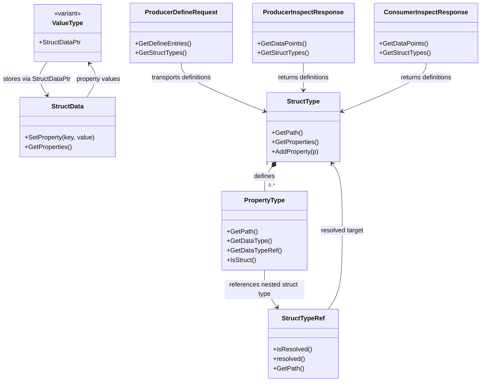

# DataBroker Struct Support

## Overview

Yoriito's DataBroker supports not only simple scalar values but also struct values composed of multiple properties. Struct support is organized into three layers.

- Value representation: the `StructDataPtr` alternative in `yoriito::ValueType` and `yoriito::StructData`
- Type definition: `yoriito::databroker::StructType`, `PropertyType`, and `StructTypeRef`
- Metadata I/O: `struct_types` in `ProducerDefineRequest` and `InspectResponse`

This structure makes it possible to represent DataBroker entry values, default values, and inspect-time type information consistently.

## Class diagram

The following diagram shows how runtime struct values, struct type definitions, and metadata transport classes are connected.



Reading the diagram from left to right:

- `StructData` is the runtime container for actual struct payloads.
- `StructType` and `PropertyType` define the schema of those payloads.
- `StructTypeRef` connects a struct-typed property or datapoint to its schema.
- Define and inspect APIs carry the resolved `StructType` definitions alongside datapoint metadata.

## Scope

### 1. Struct as a value

`yoriito::ValueType` includes `StructDataPtr`, so a struct value is stored as `std::unique_ptr<StructData>`. `StructData` is a collection of keys and values, and each property value is recursively represented by `ValueType`.

This allows the following use cases.

- Store strings, integers, floating-point values, booleans, and arrays in struct members
- Nest another struct as the value of a property
- Use struct values in `default_value` and get/set-style datapoints

Typical usage looks like this.

```cpp
yoriito::StructData address;
address.SetProperty("Street", std::string("221B Baker Street"));
address.SetProperty("Zip", std::string("NW1"));

yoriito::StructData delivery;
delivery.SetProperty("Receiver", std::string("Sherlock Holmes"));
delivery.SetProperty(
    "Address", std::make_unique<yoriito::StructData>(std::move(address)));
```

Nested structs are passed with `std::make_unique<StructData>(...)`. `StructData` equality is evaluated property by property, and nested structs are compared recursively as well.

### 2. Struct as a type

The schema of a struct is represented by `yoriito::databroker::StructType`. A `StructType` holds the path of the struct itself and the list of child `PropertyType` definitions. If a property is itself a struct, set `DataType::DATA_TYPE_STRUCT` and a `StructTypeRef` on that `PropertyType`.

```cpp
using yoriito::databroker::DataType;
using yoriito::databroker::PropertyType;
using yoriito::databroker::StructType;
using yoriito::databroker::StructTypeRef;

auto open_hours = std::make_shared<StructType>("Types.OpenHours");
open_hours->AddProperty(
    PropertyType("Types.OpenHours.Open", DataType::DATA_TYPE_UINT8));
open_hours->AddProperty(
    PropertyType("Types.OpenHours.Close", DataType::DATA_TYPE_UINT8));

auto delivery_info = std::make_shared<StructType>("Types.DeliveryInfo");
delivery_info->AddProperty(
    PropertyType("Types.DeliveryInfo.Address", DataType::DATA_TYPE_STRING));
delivery_info->AddProperty(
    PropertyType("Types.DeliveryInfo.Receiver", DataType::DATA_TYPE_STRING));
delivery_info->AddProperty(PropertyType(
    "Types.DeliveryInfo.Open",
    DataType::DATA_TYPE_STRUCT,
    StructTypeRef(open_hours)));
```

`StructType` can also carry the following metadata.

- description
- comment
- deprecation
- custom attributes

## API handling

### During define

When a producer defines a struct-typed entry, it must pass not only the datapoint definition but also the corresponding `StructType` definitions referenced by that entry. `ProducerDefineRequest` can hold both `define_entries` and `struct_types` together.

The important implementation points are:

- Set the entry `data_type` to `DATA_TYPE_STRUCT`
- Set the entry `dataTypeRef` to the target `StructType`
- Collect the required type definitions in `ProducerDefineRequest::struct_types`

### During inspect

In inspect responses, in addition to the `dataTypeRef` of each datapoint, you can retrieve the list of resolved struct type definitions through `GetStructTypes()`.

- Producer side: `yoriito::databroker::ProducerInspectResponse::GetStructTypes()`
- Consumer side: `yoriito::databroker::ConsumerInspectResponse::GetStructTypes()`

This allows the caller to reconstruct all of the following at once.

- Which datapoints are struct-typed
- The member layout of each struct
- The referenced type of nested struct properties
- The default value of struct-typed entries

## Usage flow

1. Create `StructType` objects and add the required `PropertyType` entries.
2. Set `DATA_TYPE_STRUCT` and a `StructTypeRef` on the struct-typed entry.
3. Build `StructData` when you need default values or runtime payloads.
4. Pass or receive `struct_types` together with the define/inspect APIs.

## Implementation notes

- Nested struct values are stored as `StructDataPtr`, so ownership is transferred with move semantics.
- Because `ValueType` includes struct values, copying struct payloads should rely on the existing API copy path rather than assuming trivial assignment semantics.
- `std::string_view` is a non-owning reference, so values intended for long-term storage should be materialized as `std::string` first.

## Related classes

- `yoriito::StructData`
- `yoriito::ValueType`
- `yoriito::databroker::StructType`
- `yoriito::databroker::PropertyType`
- `yoriito::databroker::StructTypeRef`
- `yoriito::databroker::ProducerDefineRequest`
- `yoriito::databroker::ProducerInspectResponse`
- `yoriito::databroker::ConsumerInspectResponse`
